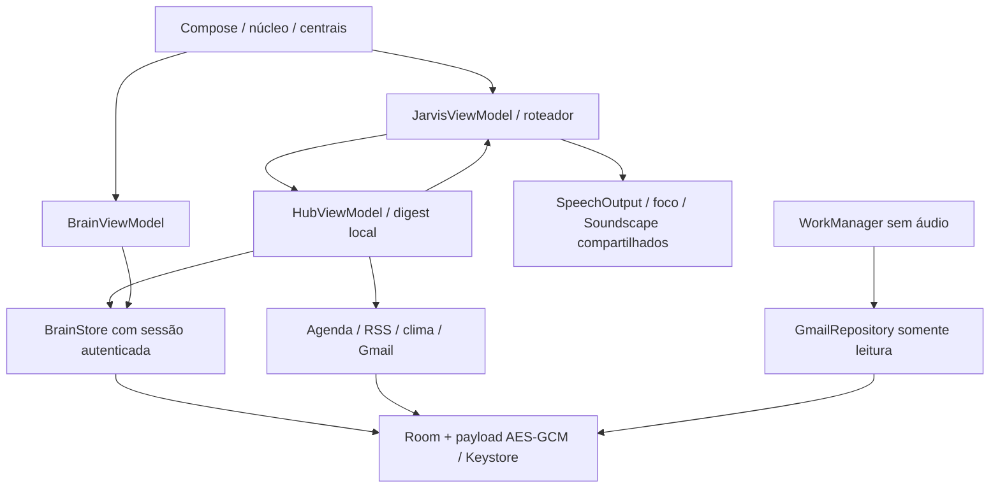

# Arquitetura 3.0 — centrais pessoais

MainActivity (FragmentActivity para autenticação nativa) integra três ViewModels e um AppData singleton. JarvisViewModel mantém voz, modos, áudio, comandos Android e conversa local; HubViewModel coordena fontes e digest; BrainViewModel mantém editor/rascunhos/backup. Comunicação por StateFlow e eventos tipados, com cancelamento/geração e lifecycle visível. Nenhum módulo cria uma segunda saída de voz.

Room v1 usa uma entidade com chave composta tipo/UUID, data e payload binário autenticado; sem FTS de texto pessoal e sem fallback destrutivo de migração. Chaves independentes para notas e cache; autenticador de sessão fecha no background. Escritas de cache carregam contador persistente de geração: desconectar/apagar invalida resultados antigos, inclusive OAuth. Reautorização da mesma conta preserva correções locais; troca de conta limpa mensagens anteriores.

HttpTransport isola HTTPS para testes determinísticos. NetworkClient limita tempo/tamanho, exige TLS, restringe Authorization ao host/caminho Gmail e não segue redirects autenticados. Sem logs de payload. RSS/Atom não aceita DTD, cache tem limite para CursorWindow; notícias grandes não quebram outros módulos. Digest usa templates e fontes independentes com deadlines, sem modelo generativo. DataStore de centrais guarda só assuntos/preferências/data da ativação diária.

WorkManager agenda leitura Gmail quando conta está conectada, com rede/bateria; reautenticação exige ação na tela. Sem áudio ou worker de wake-word. Permissões de leitura de calendário são separadas da escrita anterior. SAF exporta/importa notas com senha; ausência de OAuth não bloqueia agenda/memória/notícias/digest. [Escopo e regras](MISSAO-2.md), [privacidade](PRIVACIDADE.md), [testes](TESTES.md).

O restante documenta a base preservada da Missão 1; trechos sobre ausência de módulos/tráfego adicional referem-se à versão 0.6, não à 3.0 acima.

# Arquitetura — experiência, voz, conversa e ações

## Experiência cinematográfica (0.6)

ExperienceSettings/CorePhase são dados e políticas em Kotlin puro. ExperienceStore usa Preferences DataStore 1.1.7, um singleton por arquivo, para persistir modo, chaves/volumes e perfil vocal. A ViewModel aplica a troca imediatamente e bloqueia emissões antigas durante escritas, evitando reativar som ao selecionar Silencioso. Erro visual dura 3,5 s; o texto explicativo permanece acessível.

AssistantAudioFocus coordena uma única requisição entre SpeechOutput e Soundscape. Perda/transiente/duck interrompe a sessão e bloqueia retomada até ação do usuário. Soundscape gera o PCM original em Dispatchers.Default e usa AudioTrack estático: uma trilha em loop, um efeito curto e um loop de processamento somente no Cinema. Não mantém thread de renderização de áudio por amostra. Pausa total durante captura, redução a 12% durante fala e rampas curtas evitam competição com TTS. Silent é uma política central, não apenas volumes visuais zerados.

HolographicCore desenha vetores em Canvas, sem vídeo ou textura pesada, com cadências limitadas por modo/estado, sem timer de animação em repouso silencioso ou com Activity oculta. RMS vem do reconhecedor; onStart/onDone controlam a fase de fala e onRangeStart pulsa palavras quando disponível. O sistema pode não oferecer marcadores de palavra; nesse caso há pulso decorativo apenas durante a fala. O seletor não solicita microfone.

No Silencioso, cada toque autoriza uma única sessão e não há reinício depois da resposta/timeout. Um pedido incompleto pode ser continuado com outro toque dentro da janela. Os sons próprios do serviço de reconhecimento Android não são controláveis pelo app; usar texto evita chamar esse serviço. Nos outros modos a sessão explícita permanece até parar/sair. [Especificação e aceite](MISSAO-1.md).

## Sessão visível

A Activity solicita microfone apenas ao ativar o núcleo. A ViewModel inicia uma sessão, fala a saudação e alterna SpeechRecognizer pt-BR → interpretação → resposta falada → próxima sessão de escuta. A ativação manual autoriza a conversa enquanto o app permanece visível; Jarvis é opcional durante essa sessão. Perguntas de seleção e preenchimento de comandos expiram em 20 segundos. Pausar, sair ou bloquear cancela pedidos incompletos.

O reconhecedor usa sessões oficiais com pequenos intervalos, preferindo o mecanismo no dispositivo quando disponível. Ele é cancelado durante TTS e geração de texto, e destruído em onStop. Ao retornar, a ativação é manual. Não há serviço de microfone, inicialização por boot, acessibilidade ou escuta oculta. DownloadManager pode continuar um download de modelo explicitamente solicitado com notificação do Android, sem captura de áudio.

## Entrada e roteamento

CommandParser interpreta somente pedidos explícitos de abrir apps, agenda e alarme, preparação do modelo, ajuda e parada. Perguntas sobre esses assuntos seguem como conversa, sem executar ações por mera presença de uma palavra. Nomes e números são normalizados em Kotlin puro. A origem das ações é apenas texto/fala do usuário; respostas do modelo nunca retornam ao dispatcher.

O campo de mensagem usa o mesmo roteamento, sem precisar de RECORD_AUDIO. Dados são exibidos em StateFlow na tela Compose. Enquanto pensa, fala ou finaliza trabalho assíncrono, uma nova mensagem não se sobrepõe à anterior; o núcleo permite interromper a resposta. A execução e os callbacks são condicionados à Activity visível.

## Saída de voz

SpeechOutput usa AudioAttributes USAGE_MEDIA + CONTENT_TYPE_SPEECH, STREAM_MUSIC e foco temporário, liberado na parada/conclusão. MainActivity direciona os botões de volume para mídia. Busca a voz pt-BR disponível, prioriza opções locais e tenta outros mecanismos instalados; pt-PT serve de alternativa quando pt-BR falta. A configuração do mecanismo deve oferecer dados de voz utilizáveis.

READY, falha, volume zero, perda de foco e timeout têm tratamento explícito; a falha fica visível na tela. Cada síntese tem ID para ignorar callbacks antigos, deadline e conclusão tipada. Só reinicia a escuta depois de encerrar a reprodução/callback. Testar voz e ajustes Android permitem diagnosticar o aparelho; áudio em Bluetooth, mídia zerada, DND e ausência de dados de voz continuam dependendo do Samsung/provedor.

## Conversa local

ModelStore baixa apenas o modelo oficial indicado em assets/conversation-model.json por DownloadManager, após pedido explícito, em Wi-Fi não medido. A importação usa o seletor de documentos Android. São conferidos tamanho e SHA-256 antes de permitir inferência; arquivos diferentes são rejeitados. O modelo fica na pasta privada externa do aplicativo e é removido ao desinstalar. Preferências guardam verificação/data de modificação e ID do download. Não há token ou inference API.

LocalConversation usa JNI com llama.cpp por commit fixo, compilado pelo CMake/NDK para ARM64-v8a e x86_64. O arquivo GGUF não vai no APK/Git. O runtime usa CPU, quatro threads no máximo, contexto de 2.048 tokens e saída de até 192 tokens. Tensor math recebe otimização mesmo no APK debug; a biblioteca tem alinhamento de 16 KB. Não requer GPU, Vulkan, NPU ou serviço comercial.

ChatHistory mantém até três pares de mensagens em memória, com limite de tamanho, template ChatML e remoção de delimitadores de papéis inseridos no texto. Contexto excessivo gera nova tentativa sem os turnos anteriores. A geração roda fora da thread principal. Um ID atômico de requisição e callbacks de abortamento cancelam carregamento/cálculo ao parar. O modelo é liberado em fila após cancelamento, sem travar a Activity. Falhas de memória/carregamento são tratadas. Não grava histórico ou áudio.

O modelo não tem acesso a APIs do celular nem pesquisa internet. Pode produzir texto simples, lento ou incorreto; instruções de sistema não são comprovação de execução. Resultados reais de agenda/launcher/relógio são tratados pelo código Android separado.

## Aplicativos, agenda e alarme

InstalledApps enumera MAIN + LAUNCHER no perfil atual, sem QUERY_ALL_PACKAGES. AppResolver usa rótulos/aliases e pergunta em caso de ambiguidade. AndroidActions inicia somente o componente exportado selecionado; ChatGPT mantém pacote oficial com.openai.chatgpt. Apps de outro perfil, Pasta Segura ou sem launcher podem estar ausentes. Não automatiza telas internas de terceiros.

EventParser é Kotlin puro, usa Clock e fuso do aparelho e coleta campos ausentes. Rejeita datas/horários inválidos, passado, conflitos e recorrência não suportada. CalendarStore solicita READ_CALENDAR/WRITE_CALENDAR só no primeiro agendamento, lista agendas visíveis com escrita, lembra a escolha e revalida antes de inserir. Só confirma após ler o evento inserido e comparar título/início/fim. Não lê histórico, cria convidados ou lembretes. Sincronização da conta pertence ao provedor Android. Se uma escrita já chegou ao provedor quando a tarefa for interrompida, confira a agenda antes de repetir.

AlarmClock.ACTION_SET_ALARM e SET_ALARM são oficiais. Horário válido pede EXTRA_SKIP_UI=true; o relógio pode exigir confirmação. Não há retorno de salvamento, nem AlarmManager, exact-alarm permission ou receiver. O relógio é responsável por executar o alarme.

## Dados e evolução

INTERNET é usada para solicitar o download do modelo. O próprio app não envia texto/áudio a um backend de IA. Os provedores Android SpeechRecognizer/TTS possuem suas próprias políticas e podem usar rede; preferência offline não garante reconhecimento/fala offline. Preferências locais contêm calendário, estado do modelo e experiência/voz; não contêm gravações ou histórico permanente. Sem telemetria, servidor, chaves, assinatura ou serviços pagos.

A UI continua com relógio e bateria reais, animação Canvas enquanto STARTED, RMS fornecido pelo reconhecedor e animação ligada aos callbacks de reprodução e marcadores de palavra do TTS. O ciclo de vida pausa relógio/animação e libera o microfone ao sair.

Escuta fora da Activity exigiria um serviço de primeiro plano de tipo microphone, permissões/notification e respeito às restrições Android 12–15 e à permissão durante o uso. Não está implementada. Integração com notebook também não está implementada: uma futura rede local precisaria pareamento explícito, autenticação por dispositivo, criptografia, expiração/revogação e tratamento de conflitos. Não há bypass de restrições do sistema.
